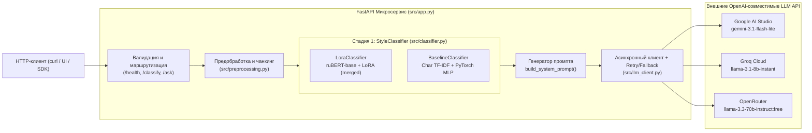
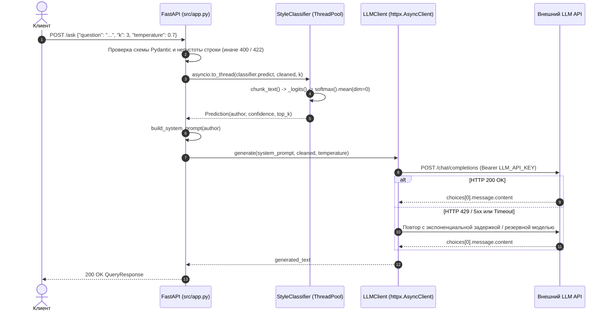

# Техническая документация проекта Literary Style Assistant

**Версия:** 1.0.0  
**Стек технологий:** Python 3.11, PyTorch 2.11 (CUDA 12.8 / CPU), Hugging Face Transformers & PEFT (LoRA), Scikit-Learn, FastAPI, Pydantic v2, HTTPX, Docker

---

## Содержание

1. [Назначение и обзор системы](#1-назначение-и-обзор-системы)
2. [Архитектура и поток управления](#2-архитектура-и-поток-управления)
3. [Модуль предобработки данных (`src/preprocessing.py`)](#3-модуль-предобработки-данных-srcpreprocessingpy)
4. [Подсистема локальной классификации стиля (`src/classifier.py`)](#4-подсистема-локальной-классификации-стиля-srcclassifierpy)
5. [Клиент внешних LLM-провайдеров (`src/llm_client.py`)](#5-клиент-внешних-llm-провайдеров-srcllm_clientpy)
6. [Спецификация REST API и контрактов данных (`src/app.py`, `src/schemas.py`)](#6-спецификация-rest-api-и-контрактов-данных-srcapppy-srcschemaspy)
7. [Справочник конфигурации и безопасность (`src/config.py`)](#7-справочник-конфигурации-и-безопасность-srcconfigpy)
8. [Артефакты моделей и воспроизводимость обучения (`models/`, `notebooks/`)](#8-артефакты-моделей-и-воспроизводимость-обучения-models-notebooks)
9. [Контейнеризация, развёртывание и эксплуатация](#9-контейнеризация-развёртывание-и-эксплуатация)
10. [Система тестирования и контроля качества (`tests/`)](#10-система-тестирования-и-контроля-качества-tests)

---

## 1. Назначение и обзор системы

**Literary Style Assistant** — двухстадийный микросервис интеллектуальной обработки русскоязычного текста, решающий две связанные задачи в едином конвейере:

1. **Атрибуция литературного стиля (Стадия 1, локальный ИИ):** определение наиболее близкого классика русской литературы по полному набору из **64 авторов** корпуса `ViliamVolosV/russian_classic_literature` без сокращения числа классов. Вычисление выполняется локально (на GPU или CPU) с возвратом предсказанного автора и калиброванной оценки уверенности (`confidence`).
2. **Управляемая стилизация (Стадия 2, внешний LLM API):** динамическая сборка системного промпта под найденного автора и асинхронный вызов внешнего генеративного API (**Google AI Studio / Gemini**, **Groq Cloud** или **OpenRouter**) для продолжения текста или ответа на запрос пользователя с сохранением лексики, синтаксиса, ритмики и пунктуации автора.

---

## 2. Архитектура и поток управления

### 2.1. Компонентная схема



### 2.2. Последовательность обработки запроса `POST /ask`



### 2.3. Управление жизненным циклом (`lifespan`)

Контекстный менеджер `lifespan(app: FastAPI)` в `src/app.py` гарантирует отсутствие повторного чтения весов на запросах и корректную выгрузку ресурсов:
* **На старте:** загружает конфигурацию `Settings`, десериализует `models/tfidf_vectorizer.pkl` в `app.state.vectorizer`, инициализирует выбранный классификатор (`LoraClassifier` либо `BaselineClassifier`) в `app.state.classifier` и открывает пул соединений `httpx.AsyncClient` в `app.state.llm_client`.
* **При остановке:** закрывает HTTP-соединения (`await llm_client.aclose()`), очищает ссылки на веса (`classifier.close()`), вызывает сборщик мусора `gc.collect()` и освобождает кэш видеопамяти `torch.cuda.empty_cache()`.

---

## 3. Модуль предобработки данных (`src/preprocessing.py`)

Модуль используется совместно исследовательскими ноутбуками (`notebooks/`) и продакшен-сервисом (`src/`), чем исключается расхождение признаков между обучением и инференсом (*train-serving skew*).

### Ключевые функции

| Функция | Сигнатура | Описание |
|---|---|---|
| `extract_author` | `(user_message: str) -> str \| None` | Извлекает имя автора основным регулярным выражением `r"стиле автора ([^\"]+)"` либо резервным `r"автора\s+([^\"]+?)\s*$"`, покрывая все 4 шаблона реплик датасета (100 % из 8 018 записей `train`). |
| `clean_text` | `(text: str) -> str` | Декодирует буквальные экранирования (`\\r\\n`, `\\n`, `\\t`, `\\"`, `\\'`), нормализует переводы строк к `\n`, удаляет управляющие ASCII-символы `[\x00-\x08\x0b\x0c\x0e-\x1f\x7f]`, схлопывает неразрывные/тонкие пробелы (`\u00a0`, `\u2009`, `\u200b`, `\ufeff`) и удаляет пустые строки. |
| `normalize_for_model` | `(text: str) -> str` | Применяет `clean_text` и схлопывает все пробельные последовательности `\s+` в одиночный пробел, устраняя зависимость от книжной вёрстки переносов строк. |
| `chunk_text` | `(text: str, chunk_chars: int = 1000, min_chars: int = 200) -> list[str]` | Разбивает нормализованный текст по границам слов на блоки длиной ~`chunk_chars`. Если последний блок короче `min_chars` и в списке уже есть блоки, он присоединяется к предыдущему, предотвращая шумные сверхкороткие «хвосты». |
| `iter_jsonl` | `(path: str \| Path) -> Iterable[dict]` | Потоковое чтение JSON Lines файлов в кодировке UTF-8. |
| `parse_record` | `(record: dict) -> tuple[str \| None, str]` | Извлекает пару `(author, assistant_text)` из диалоговой структуры `{"messages": [...]}`. |

---

## 4. Подсистема локальной классификации стиля (`src/classifier.py`)

### 4.1. Базовый абстрактный класс `StyleClassifier`

* Вычисление защищено мьютексом `threading.Lock()` и контекстом `torch.inference_mode()` для безопасного параллельного вызова из пула потоков `asyncio.to_thread`.
* Для входного текста формируется до `settings.max_chunks` (по умолчанию `16`) фрагментов. Для каждого фрагмента $m \in \{1, \dots, M\}$ модель выдаёт вектор сырых логитов $z_m \in \mathbb{R}^{C}$ ($C = 64$), после чего итоговое распределение вероятностей вычисляется усреднением:
  $$\bar{p} = \frac{1}{M} \sum_{m=1}^{M} \operatorname{softmax}(z_m)$$
* Предсказанный класс $\hat{y} = \arg\max_c \bar{p}_c$, уверенность $\text{confidence} = \bar{p}_{\hat{y}}$.

### 4.2. Бэкенд `baseline`: `BaselineClassifier` и `TextClassifier`

* **Векторизация:** `TfidfVectorizer(analyzer="char", lowercase=True, ngram_range=(2, 4), max_features=50000, sublinear_tf=True, dtype=np.float32)` без морфологической лемматизации.
* **Нейросетевая архитектура (`TextClassifier`):**
  * `nn.Linear(50000, 128)` -> `nn.ReLU()` -> `nn.Linear(128, 64)`.
  * Выходной слой возвращает **строго сырые логиты** (без `Softmax`/`LogSoftmax`), совместимые с `nn.CrossEntropyLoss` при обучении.
* **Формат чекпоинта `models/baseline_pytorch.pt`:** словарь с ключами `model_state_dict`, `optim_state_dict`, `epoch` (`20`), `in_features` (`50000`), `num_classes` (`64`), `classes` (`list[str]`), загружаемый безопасно с флагом `weights_only=True`.

### 4.3. Бэкенд `lora`: `LoraClassifier`

* **Базовый энкодер:** `ai-forever/ruBert-base` (`12` слоёв трансформера, `hidden_size=768`, `180.8M` параметров с классификационной головой).
* **Параметро-эффективная адаптация LoRA:** для целевых линейных проекций `query`, `value` и `dense` веса модифицируются низкоранговой добавкой ранга $r = 16$ с масштабом $\alpha = 32$:
  $$W' = W_0 + \frac{\alpha}{r} B A, \quad A \in \mathbb{R}^{r \times d_{\text{in}}},\; B \in \mathbb{R}^{d_{\text{out}} \times r}$$
* **Оптимизация инференса:** при старте сервиса вызывается `PeftModel.from_pretrained(base, lora_dir).merge_and_unload()`, вливающая матрицы $\frac{\alpha}{r} B A$ непосредственно в базовые тензоры $W_0$. На GPU RTX (архитектура Ampere/Ada/Blackwell) прямой проход выполняется под `torch.autocast("cuda", dtype=torch.bfloat16)`.
* **Автоматический откат:** функция-фабрика `load_classifier()` при отсутствии каталога `models/lora_classifier` логирует предупреждение и прозрачно переключается на `BaselineClassifier`.

---

## 5. Клиент внешних LLM-провайдеров (`src/llm_client.py`)

### 5.1. Поддерживаемые провайдеры и автоопределение

При `LLM_PROVIDER=auto` (значение по умолчанию) провайдер определяется автоматически по префиксу `LLM_API_KEY`:

| Провайдер | Префикс ключа | Базовый URL (`resolved_base_url`) | Основная модель | Резервные модели (`fallback_models`) |
|---|---|---|---|---|
| **Google AI Studio** (`aistudio`) | `AQ.` или `AIza` | `https://generativelanguage.googleapis.com/v1beta/openai` | `gemini-3.1-flash-lite` | `gemini-flash-lite-latest`, `gemma-4-31b-it` |
| **Groq Cloud** (`groq`) | `gsk_` *(и прочие)* | `https://api.groq.com/openai/v1` | `llama-3.1-8b-instant` | — |
| **OpenRouter** (`openrouter`) | `sk-or-` | `https://openrouter.ai/api/v1` | `meta-llama/llama-3.3-70b-instruct:free` | — |

### 5.2. Системный промпт стилизации

Функция `build_system_prompt(predicted_author)` формирует контекстную инструкцию:
> *«Ты — стилизатор русской классической литературы. Входной текст идентифицирован как стиль автора: {predicted_author}. Ответь на запрос пользователя или продолжи повествование, строго воспроизводя лексику, синтаксис, пунктуационные особенности и образы автора {predicted_author}.»*

### 5.3. Обработка отказов и ретраи

* На временных сбоях (`HTTP 429, 500, 502, 503, 504`, `httpx.TimeoutException`, сетевые ошибки транспорта) клиент выполняет повторные попытки с экспоненциальной задержкой (`1s`, `2s`, ...) и переключением на следующую модель из `candidate_models`.
* На ошибках авторизации (`HTTP 401, 403`) клиент завершает вызов немедленно без повторных запросов (`LLMError`, статус `502`).
* Если `LLM_API_KEY` не задан или пуст, выбрасывается `LLMError` со статусом `503 Service Unavailable`.

---

## 6. Спецификация REST API и контрактов данных (`src/app.py`, `src/schemas.py`)

### 6.1. `GET /health`

Проверка жизнеспособности контейнера и готовности локальной модели.

* **Ответ `200 OK` (`HealthResponse`):**
  ```json
  {
    "status": "ok",
    "model_loaded": true
  }
  ```

### 6.2. `POST /classify`

Локальная классификация стиля автора (Стадия 1) с выдачей распределения `top-k` авторов. Не требует наличия внешнего ключа `LLM_API_KEY`.

* **Тело запроса (`QueryRequest`):**
  * `question` (`str`, обязательное, длина `1..15000` знаков, непустая строка после нормализации) — литературный фрагмент или запрос;
  * `k` (`int`, по умолчанию `3`, диапазон `1..10`) — размер списка наиболее вероятных авторов;
  * `temperature` (`float`, по умолчанию `0.7`, диапазон `0.0..2.0`) — не влияет на `/classify`, сохранено для единого контракта запроса.
* **Ответ `200 OK` (`ClassifyResponse`):**
  ```json
  {
    "predicted_author": "Достоевский Ф",
    "confidence": 0.9412,
    "model_name": "rubert-base-lora",
    "top_authors": [
      {"author": "Достоевский Ф", "probability": 0.9412},
      {"author": "Андреев Л", "probability": 0.0215},
      {"author": "Гоголь Н", "probability": 0.0108}
    ]
  }
  ```

### 6.3. `POST /ask`

Полный двухстадийный конвейер: классификация стиля + генерация стилизованного ответа внешней LLM.

* **Тело запроса:** `QueryRequest` (`question`, `k`, `temperature`).
* **Ответ `200 OK` (`QueryResponse`):**
  ```json
  {
    "predicted_author": "Лажечников И",
    "confidence": 0.7169,
    "model_name": "rubert-base-lora",
    "generated_text": "Младое сердце радостно замирает в груди..."
  }
  ```

### 6.4. Коды ошибок API

| HTTP-код | Причина возникновения | Тело ответа |
|---|---|---|
| `400 Bad Request` | Поле `question` равно `""` или состоит только из пробельных символов (`"   "`, `"\t\n"`) | `{"detail": "Пустой вопрос"}` |
| `422 Unprocessable Entity` | Отсутствует обязательное поле `question` либо нарушены границы `k` (`1..10`) / `temperature` (`0.0..2.0`) | Стандартный список ошибок Pydantic |
| `502 Bad Gateway` | Ошибка авторизации (`401/403`), некорректный ответ или исчерпание ретраев внешнего LLM API | `{"detail": "Ошибка внешнего LLM API: ..."}` |
| `503 Service Unavailable` | Не задан `LLM_API_KEY` либо не загружена локальная модель классификатора | `{"detail": "LLM_API_KEY не задан..."}` |
| `504 Gateway Timeout` | Превышен тайм-аут `LLM_TIMEOUT` на всех попытках обращения к внешней LLM | `{"detail": "Ошибка внешнего LLM API: тайм-аут..."}` |

---

## 7. Справочник конфигурации и безопасность (`src/config.py`)

Все параметры управляются через класс `Settings(BaseSettings)` и считываются из переменных окружения ОС или локального файла `.env`:

| Переменная | Тип | По умолчанию | Описание |
|---|---|---|---|
| `LLM_API_KEY` | `SecretStr \| None` | `None` | API-ключ к Google AI Studio, Groq Cloud или OpenRouter |
| `LLM_PROVIDER` | `auto\|groq\|openrouter\|aistudio` | `auto` | Явный выбор провайдера либо автоопределение по префиксу ключа |
| `LLM_BASE_URL` | `str \| None` | `None` | Переопределение базового URL OpenAI-совместимого API |
| `LLM_MODEL` | `str \| None` | `None` | Принудительное имя внешней LLM-модели |
| `LLM_TIMEOUT` | `float` | `25.0` | Тайм-аут одного HTTP-запроса к внешнему API в секундах |
| `LLM_MAX_TOKENS` | `int` | `1024` | Максимальное число генерируемых токенов (`16..8192`) |
| `LLM_MAX_RETRIES` | `int` | `2` | Число дополнительных попыток при временной ошибке LLM API (`0..5`) |
| `CLASSIFIER_BACKEND` | `lora\|baseline` | `lora` | Выбор локальной модели классификации стиля |
| `MODELS_DIR` | `Path` | `<root>/models` | Путь к директории с весами и векторизатором |
| `DEVICE` | `auto\|cpu\|cuda` | `auto` | Устройство вычислений PyTorch (`auto` выбирает `cuda` при наличии) |
| `CHUNK_CHARS` | `int` | `1000` | Целевая длина текстового фрагмента в символах |
| `MAX_CHUNKS` | `int` | `16` | Верхний предел числа фрагментов на один входной запрос |

### Меры информационной безопасности
* Поле `llm_api_key` обёрнуто в тип `pydantic.SecretStr`, маскирующий секрет при дампе настроек и в трассировках исключений (`SecretStr('**********')`).
* Файлы `.env` и `.env.*` исключены из индекса Git (`.gitignore`) и контекста сборки образа (`.dockerignore`).
* В `Dockerfile` отсутствуют директивы `ARG`/`ENV` с ключами — секрет передаётся исключительно при старте контейнера (`docker run -e LLM_API_KEY=...`).

---

## 8. Артефакты моделей и воспроизводимость обучения (`models/`, `notebooks/`)

| Путь | Назначение | Размер |
|---|---|---:|
| `models/tfidf_vectorizer.pkl` | Обученный посимвольный `TfidfVectorizer` (`(2,4)`, `50 000` признаков, `float32`) | `1.56 МБ` |
| `models/label_encoder.pkl` | `LabelEncoder` со списком всех `64` авторов | `2 КБ` |
| `models/baseline_pytorch.pt` | Чекпоинт `TextClassifier` (`model_state_dict`, `optim_state_dict`, метаданные) | `73.35 МБ` |
| `models/lora_classifier/adapter_model.safetensors` | Веса LoRA-адаптера и классификационной головы `ruBert-base` | `9.30 МБ` |
| `models/lora_classifier/adapter_config.json` | Параметры PEFT (`r=16`, `lora_alpha=32`, `target_modules`) | `1 КБ` |
| `models/lora_classifier/labels.json` | Словарь классов (`64` автора), `max_length=256` и имя базового энкодера | `2 КБ` |
| `models/lora_classifier/tokenizer.json` | Быстрый Rust-токенизатор WordPiece | `3.54 МБ` |

Полный цикл исследований воспроизводится по порядку выполнения ноутбуков:
1. `notebooks/01_eda_and_cleaning.ipynb` -> `data/processed/parsed_*.parquet`, `chunks_*.parquet`
2. `notebooks/02_tfidf_experiments.ipynb` -> `models/tfidf_vectorizer.pkl`, `models/label_encoder.pkl`
3. `notebooks/03_pytorch_baseline.ipynb` -> `models/baseline_pytorch.pt`
4. `notebooks/04_lora_finetuning.ipynb` -> `models/lora_classifier/`

---

## 9. Контейнеризация, развёртывание и эксплуатация

### 9.1. Локальный запуск (Windows PowerShell / Linux)

```powershell
cd SovTehS
.venv\Scripts\uvicorn.exe src.app:app --host 0.0.0.0 --port 8000
```

### 9.2. Сборка и запуск в Docker

Оптимизации `Dockerfile`:
1. Базовый образ `python:3.11-slim` с `PYTHONDONTWRITEBYTECODE=1` и `PYTHONUNBUFFERED=1`.
2. Установка CPU-сборки PyTorch (`--index-url https://download.pytorch.org/whl/cpu`) перед `requirements.txt`, сокращающая размер образа на ~`2.5 ГБ`.
3. Предварительное кэширование базового энкодера `ai-forever/ruBert-base` в отдельном кэшируемом слое до копирования `src/` и `models/` — контейнер поднимается за ~2 секунды без скачивания 700 МБ при каждом запуске.

```bash
docker build -t doc-assistant .
docker run --rm -p 8000:8000 -e LLM_API_KEY="your_api_key_here" doc-assistant
```

### 9.3. Рекомендации по выбору бэкенда под профиль нагрузки

* **`CLASSIFIER_BACKEND=lora` (по умолчанию):** оптимален при наличии GPU (`8.1 мс` на запрос) либо при умеренном RPS на CPU (`84.5 мс`), обеспечивает максимальный Macro-F1 на редких авторах при агрегации по длинным текстам (`98.53 %`).
* **`CLASSIFIER_BACKEND=baseline`:** оптимален для легковесных CPU-контейнеров с жёсткими лимитами памяти и высоким RPS — задержка классификации составляет **`1.99 мс`** на CPU при потреблении менее `150 МБ` RAM.

---

## 10. Система тестирования и контроля качества (`tests/`)

Пакет тестов разделён на четыре специализированных модуля:

| Модуль | Проверяемая функциональность |
|---|---|
| `tests/test_preprocessing.py` | Все 4 шаблона извлечения автора, очистка битых экранирований и спецсимволов, нормализация, граничные случаи нарезки `chunk_text`, чтение JSONL. |
| `tests/test_config_and_llm.py` | Автоопределение провайдеров (`Groq`, `OpenRouter`, `AI Studio`), приоритет переопределений, системный промпт, ретраи на `503` с переключением на fallback-модель, fast-fail на `401`, обработка тайм-аутов (`504`) и битого JSON (`502`). |
| `tests/test_classifiers.py` | Отсутствие `Softmax` внутри `TextClassifier`, проверка градиентов `CrossEntropyLoss`, целостность сохранённых весов в `models/`, одно- и многофрагментный инференс `BaselineClassifier` и `LoraClassifier`. |
| 	ests/test_api_and_e2e.py | Жизненный цикл lifespan, контракт /health, обработка пустых/пробельных вопросов (400), невалидных параметров (422), ошибок провайдера (503/504) и **живой сквозной тест POST /ask с реальной моделью 
uBERT+LoRA и внешним API Google AI Studio**. |
| 	ests/test_adversarial_and_robustness.py | Стресс-тесты безопасности и DoS: защита от падения на невидимых пробелах/контрольных байтах (400 вместо 500), блокировка инъекций через имя автора, нарезка монолитных токенов (DoS), лимит длины 15000 и OOD-тесты. |

Команды запуска проверок:

```powershell
# Полный прогон тестов с отчётом покрытия кода src/
.venv\Scripts\pytest.exe tests -v --cov=src --cov-report=term-missing

# Статический анализ и проверка соответствия PEP8
uv tool run ruff check src tests --line-length 100
```


