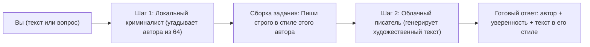

# Простое объяснение проекта и подробная инструкция к пользованию

Этот документ состоит из двух частей:
1. **Часть 1 — Упрощённое объяснение («на пальцах»):** что делает проект, зачем он устроен именно так, какие две нейросети живут внутри и что лежит в каждой папке.
2. **Часть 2 — Подробная инструкция пользователя:** как установить, настроить ключ, запустить сервер, отправлять запросы через браузер, консоль или Python, переключать модели и решать любые неполадки.

---

## Часть 1. Упрощённое объяснение: как работает и что содержит проект

### 1.1. Главная идея в двух словах

Представьте литературную мастерскую, в которой сидят два специалиста:
1. **Литературовед-криминалист** (работает **локально** на вашем компьютере, без интернета). Вы даёте ему любой отрывок текста или фразу — и он за доли секунды определяет, на чью манеру письма из **64 русских классиков** (от Пушкина, Гоголя, Достоевского и Толстого до Лескова, Розанова, Аверченко и Братьев Стругацких) этот текст похож больше всего.
2. **Писатель-стилизатор** (большая облачная нейросеть — Google Gemini, Llama в Groq или OpenRouter). Получив от криминалиста точный вердикт — например, *«Это Достоевский Ф с уверенностью 91%»* — стилизатор получает строгую инструкцию перевоплотиться в этого автора и продолжить ваш текст или ответить на ваш вопрос его языком, ритмом фразы и пунктуацией.



### 1.2. Зачем две стадии, если можно просто спросить большую нейросеть напрямую?

Казалось бы: почему не отправить текст сразу в большую языковую модель и не попросить её саму угадать автора? На практике двухстадийная схема решает сразу три проблемы:
* **Точность на редких авторах.** В датасете проекта **64 писателя** — среди них не только школьная классика, но и авторы XIX–XX веков со специфическим слогом: Вельтман, Нарежный, Загоскин, Помяловский, Слепцов, Вагинов, Чарская и др. Обычный чат-бот почти всегда «сваливается» к 5 самым известным фамилиям, тогда как наша локальная модель специально обучена на **110 285 реальных отрывках** всех 64 авторов и угадывает автора целого текста с точностью **более 99%**.
* **Скорость и бесплатность проверки.** Первая стадия работает прямо на вашей видеокарте или процессоре за миллисекунды и не тратит платные токены внешнего API. Вы можете вызывать режим `/classify` хоть тысячи раз без интернета и без API-ключа.
* **Чистота генерации.** Когда большая нейросеть заранее получает точное имя автора в скрытом системном задании, она не тратит силы на догадки и сразу концентрируется на художественной имитации стиля.

> [!NOTE]
> Полный список всех **64 поддерживаемых авторов** хранится в файле [labels.json](../models/lora_classifier/labels.json) — ни один автор из исходного датасета не был удалён.

---

### 1.3. Как компьютер узнаёт авторский почерк? Два «мозга» внутри проекта

В проекте обучены и сохранены сразу **две разные локальные нейросети** для определения автора. Между ними можно переключаться одной настройкой (`CLASSIFIER_BACKEND`).

#### Вариант 1: `lora` (`rubert-base-lora`) — включён по умолчанию
* **Как работает простыми словами:** За основу взята большая русскоязычная модель-трансформер `ruBERT-base` от Sber AI (178 млн параметров), которая уже заранее «прочитала» огромный корпус русского языка и понимает смысл слов, интонацию и грамматику. Чтобы научить её различать 64 писателей, мы не переучивали всю гигантскую сеть целиком, а применили метод **LoRA** — прикрепили к внутренним слоям модели компактные обучаемые «линзы-адаптеры» (обучалось всего **1.35%** весов).
* **Сколько весит:** Сам обученный адаптер в папке `models/lora_classifier/` занимает всего **9.3 МБ**! При запуске сервера он автоматически склеивается с базовым `ruBERT-base` в единую быструю модель.
* **В чём сильна:** Лучше всех чувствует контекст, лексику и редких авторов на развёрнутых отрывках (средняя точность Macro-F1 по целым текстам — **98.53%**).

#### Вариант 2: `baseline` (`pytorch-mlp-char-tfidf`) — сверхбыстрый классический нейросетевой вариант
* **Как работает простыми словами:** Эта модель вообще не смотрит на «слова целиком» и не приводит их к словарной форме (не делает лемматизацию). Вместо этого она скользит по тексту окошком в **2, 3 и 4 символа подряд** (буквы + пробелы + знаки препинания) и считает частоту 50 000 самых характерных комбинаций: например, `", а "`, `" — "`, `"-с,"`, `"ться"`, `"ость"`.
* **Почему нельзя приводить слова к начальной форме?** Если превратить *«милостивый государь-с, позвольте-ка...»* в сухой набор словарных основ *«милостивый государь позволить»*, исчезнут частицы *«-с»*, *«-ка»*, тире, многоточия и любимые падежные окончания писателя — то есть сотрётся сам авторский стиль! Эксперименты в ноутбуке [02_tfidf_experiments.ipynb](../notebooks/02_tfidf_experiments.ipynb) доказали это математически: посимвольный анализ работает в десятки раз быстрее и даёт гораздо более высокую точность.
* **В чём сильна:** Молниеносная скорость (**~1.3 мс** на видеокарте и **~2 мс** даже на обычном процессоре) и отличная цепкость к авторской пунктуации на коротких абзацах (**94.35%** точности на фрагментах по 1000 символов).

| Характеристика | `lora` (`ruBERT-base + LoRA`) — по умолчанию | `baseline` (`char TF-IDF + PyTorch MLP`) |
| :--- | :--- | :--- |
| **Принцип анализа** | Смысл, контекст и словесные конструкции (трансформер) | Пунктуация, суффиксы, буквенные сочетания по 2–4 символа |
| **Точность на целых произведениях (Macro-F1)** | **98.53%** (лучше на редких авторах) | 96.85% |
| **Точность на кусках ~1000 символов (Accuracy)** | 91.72% | **94.35%** |
| **Скорость ответа на процессоре (CPU)** | ~85 мс | **~2 мс** (в 42 раза быстрее) |
| **Когда выбирать** | Основной режим (особенно если есть видеокарта NVIDIA) | Слабый ноутбук без видеокарты или нужна мгновенная реакция |

---

### 1.4. Зачем резать длинный текст на кусочки по ~1000 символов?

Если вы отправите в сервис длинный отрывок (например, 5–10 тысяч знаков), программа не пытается «впихнуть» его в нейросеть целиком (у трансформеров ограничено окно чтения, и хвост текста просто обрезался бы). Вместо этого работает **алгоритм голосования фрагментов (чанков)**:
1. Текст очищается от мусорных спецсимволов и аккуратно **по границам слов** нарезается на кусочки примерно по **1000 символов** (до 16 кусочков за раз).
2. Нейросеть оценивает **каждый кусочек отдельно** и выдаёт для него вероятности всех 64 авторов от `0` до `1`.
3. Вероятности по всем кусочкам **усредняются**. Победителем становится автор с наибольшим средним баллом. Благодаря этому даже если в одном абзаце встретился нетипичный диалог, остальные абзацы вытянут правильный ответ.

---

### 1.5. Что содержит проект? Простая карта всех папок

Весь проект находится в папке `literary-style-assistant`:

| Папка / файл | Что там лежит простыми словами | Нужна ли для запуска сервера? |
| :--- | :--- | :--- |
| `src/` | **Сердце программы (боевой код сервера).** 6 компактных Python-файлов, которые принимают запросы, чистят текст, запускают нейросеть и общаются с внешней LLM. | **Да, обязательно** |
| `models/` | **«Мозги» проекта (обученные веса).** Содержит словарь буквенных признаков (`tfidf_vectorizer.pkl`), список 64 авторов (`label_encoder.pkl`), веса быстрой нейросети (`baseline_pytorch.pt`) и папку адаптера трансформера (`lora_classifier/`). | **Да, обязательно** |
| `.env` | **Ваш личный сейф с настройками.** Текстовый файл, где записан ваш секретный ключ `LLM_API_KEY`. Скрыт от Git и Docker, чтобы ключ случайно не попал в интернет. | **Да** (для генерации `/ask`) |
| `notebooks/` | **Научная лаборатория (4 ноутбука Jupyter).** История того, как скачивались книги, чистились данные, проверялись гипотезы и с нуля обучались обе нейросети. | Нет (нужна только для изучения или переобучения) |
| `data/` | **Книжный архив.** В `data/raw/` лежат скачанные исходные датасеты, а в `data/processed/` — очищенные и нарезанные таблицы Parquet (110 тыс. обучающих фрагментов). | Нет (нужна только для переобучения в ноутбуках) |
| `tests/` | **Автоматический отдел контроля качества.** 22 теста, которые проверяют каждую деталь программы — от очистки текста до живого общения с нейросетью. | Нет (запускается по желанию для самопроверки) |
| `reports/` | **Графики и таблицы результатов.** Картинки кривых обучения, матрицы ошибок и замеры скорости. | Нет (справочные материалы) |
| `docs/` и `REPORT.md` | **Документация и научный отчёт.** Инструкции, описание кода и аналитический разбор экспериментов. | Нет |
| `Dockerfile` | **Чертёж автономного контейнера.** Позволяет упаковать весь сервис в изолированную «коробку» Docker для запуска на любом сервере одной командой. | Только при запуске через Docker |

---

## Часть 2. Подробная пошаговая инструкция к пользованию

### Шаг 1. Подготовка и установка (если запускаете впервые)

> [!TIP]
> Если вы работаете на текущем компьютере, виртуальное окружение `.venv`, обе обученные модели в `models/` и файл `.env` **уже полностью настроены** — можете сразу переходить к **Шагу 3 (Запуск сервера)**! Шаги 1 и 2 нужны при переносе проекта на новый компьютер.

**Системные требования:**
* ОС: Windows 10/11, Linux или macOS.
* Python: версия **3.11** (рекомендуется) или 3.12.
* Оперативная память: минимум **4 ГБ** свободной ОЗУ (для режима `baseline` достаточно **1.5 ГБ**).
* Видеокарта: необязательна (сервис автоматически работает и на NVIDIA GPU, и на обычном процессоре CPU).

Откройте терминал **PowerShell** и перейдите в папку проекта:

```powershell
cd SovTehS
```

Создайте виртуальное окружение и установите библиотеки (выберите один из двух вариантов):

**Вариант А — У вас есть видеокарта NVIDIA (быстрая работа на GPU):**
```powershell
python -m venv .venv
.venv\Scripts\pip install torch --index-url https://download.pytorch.org/whl/cu128
.venv\Scripts\pip install -r requirements.txt
```

**Вариант Б — Обычный компьютер или ноутбук без видеокарты NVIDIA (работа на CPU, экономит ~2.5 ГБ места):**
```powershell
python -m venv .venv
.venv\Scripts\pip install torch --index-url https://download.pytorch.org/whl/cpu
.venv\Scripts\pip install -r requirements.txt
```

---

### Шаг 2. Настройка API-ключа для генерации текста (`.env`)

Для работы второй стадии (генерации стилизованного текста в `/ask`) нужен бесплатный ключ одного из трёх облачных провайдеров. Сервис **сам узнаёт провайдера по первым символам вашего ключа**:

1. **Google AI Studio** *(рекомендуется)* — получите ключ на https://aistudio.google.com/apikey (ключ начинается на `AQ.` или `AIza`). Автоматически включится быстрая модель `gemini-3.1-flash-lite` с запасными моделями `gemini-flash-lite-latest` и `gemma-4-31b-it` на случай перегрузки серверов Google.
2. **Groq Cloud** — получите ключ на https://console.groq.com/keys (начинается на `gsk_`). Автоматически включится `llama-3.1-8b-instant`.
3. **OpenRouter** — получите ключ на https://openrouter.ai/keys (начинается на `sk-or-`). Автоматически включится бесплатная модель `meta-llama/llama-3.3-70b-instruct:free`.

Скопируйте шаблон [.env.example](../.env.example) в файл `.env` в корне проекта и впишите свой ключ:

```powershell
Copy-Item .env.example .env
notepad .env
```

Содержимое файла `.env`:
```ini
LLM_API_KEY=вставьте_ваш_ключ_сюда_без_кавычек
LLM_PROVIDER=auto
CLASSIFIER_BACKEND=lora
DEVICE=auto
```

#### Полный справочник всех настроек `.env`

| Переменная | По умолчанию | Допустимые значения | Что она меняет простыми словами |
| :--- | :--- | :--- | :--- |
| `LLM_API_KEY` | *(пусто)* | строка ключа | Секретный ключ для генерации текста в `/ask` (для `/classify` не нужен). |
| `LLM_PROVIDER` | `auto` | `auto`, `aistudio`, `groq`, `openrouter` | Облачный сервис генерации (`auto` определяет сам по префиксу ключа). |
| `CLASSIFIER_BACKEND` | `lora` | `lora`, `baseline` | Какой локальной нейросетью угадывать автора (`lora` — трансформер ruBERT, `baseline` — быстрый посимвольный MLP). |
| `DEVICE` | `auto` | `auto`, `cuda`, `cpu` | На чём считать локальную нейросеть (`auto` выберет видеокарту `cuda`, если она есть, иначе процессор `cpu`). |
| `LLM_MODEL` | *(зависит от провайдера)* | имя модели | Принудительный выбор конкретной облачной модели (например, `gemini-flash-lite-latest`). |
| `LLM_BASE_URL` | *(зависит от провайдера)* | HTTP URL | Позволяет подключить любой собственный OpenAI-совместимый сервер (например, локальный Ollama `http://localhost:11434/v1`). |
| `LLM_TIMEOUT` | `25.0` | секунды (`> 0`) | Сколько секунд ждать ответа от облачной нейросети до ошибки тайм-аута. |
| `LLM_MAX_TOKENS` | `1024` | от `16` до `8192` | Максимальная длина генерируемого художественного ответа. |
| `LLM_MAX_RETRIES` | `2` | от `0` до `5` | Сколько раз автоматически повторять запрос при кратковременном сбое облака. |
| `CHUNK_CHARS` | `1000` | `>= 100` | Размер одного кусочка текста (в символах) при анализе длинных произведений. |
| `MAX_CHUNKS` | `16` | `>= 1` | Максимум кусочков на один запрос (`16` кусочков = ~16 000 символов текста). |

> [!WARNING]
> Никогда не вставляйте реальный `LLM_API_KEY` внутрь файлов `.py`, `Dockerfile` или `.env.example` — храните его только в файле `.env` или передавайте через переменную окружения терминала.

---

### Шаг 3. Запуск и остановка сервера

В терминале PowerShell из папки проекта выполните:

```powershell
cd SovTehS
.venv\Scripts\uvicorn.exe src.app:app --host 0.0.0.0 --port 8000
```

* При первом в жизни запуске режима `lora` программа один раз скачает базовую модель `ai-forever/ruBert-base` (~700 МБ) в стандартный кэш Hugging Face на вашем диске. Все последующие запуски занимают **2–4 секунды**.
* Когда в консоли появится строка:
  `INFO:     Uvicorn running on http://0.0.0.0:8000 (Press CTRL+C to quit)`
  — **сервер готов к работе!** Не закрывайте это окно, пока пользуетесь сервисом.
* **Чтобы остановить сервер:** нажмите сочетание клавиш `Ctrl + C` в окне терминала — программа аккуратно очистит память видеокарты и завершится.

---

### Шаг 4. Четыре способа пользоваться сервисом

Пока сервер запущен, вы можете обращаться к нему любым удобным способом:

#### Способ 1. Через браузер (Swagger UI — самый наглядный, без написания кода!)

1. Откройте браузер и перейдите по адресу: **http://localhost:8000/docs**
2. Перед вами откроется интерактивная панель управления с тремя цветными кнопками:
   * `GET /health` — проверка состояния сервера;
   * `POST /classify` — только определить автора (бесплатно и офлайн);
   * `POST /ask` — определить автора и сгенерировать текст в его стиле.
3. Нажмите на нужную плашку (например, **`POST /ask`**) → справа нажмите кнопку **«Try it out»**.
4. В поле **Request body** впишите свой текст вместо примера:
   ```json
   {
     "question": "В душном петербургском переулке у жёлтого фонаря остановился бледный господин в потёртом пальто и вдруг лихорадочно зашептал...",
     "k": 3,
     "temperature": 0.7
   }
   ```
5. Нажмите синюю кнопку **«Execute»**.
6. Чуть ниже в блоке **Server response (Code 200)** появится готовый результат: угаданный автор (`predicted_author`), уверенность модели (`confidence`), название модели (`model_name`) и художественное продолжение текста (`generated_text`)!

---

#### Способ 2. Из терминала Windows PowerShell

Откройте **второе** окно PowerShell (первое окно крутит сервер). Чтобы кириллица в Windows гарантированно передавалась без искажений кодировки, используйте `Encoding::UTF8`:

**Запрос №1 — Полный цикл: угадать автора + продолжить текст (`/ask`):**
```powershell
$body = @{
    question    = "Какая прекрасная ночь над Невой, но отчего так тревожно и тесно сердцу в этом жёлтом тумане..."
    k           = 3
    temperature = 0.7
} | ConvertTo-Json

Invoke-RestMethod -Method Post -Uri "http://localhost:8000/ask" `
    -ContentType "application/json; charset=utf-8" `
    -Body ([System.Text.Encoding]::UTF8.GetBytes($body))
```

**Запрос №2 — Только узнать автора и посмотреть Топ-5 похожих классиков (`/classify`, работает без API-ключа):**
```powershell
$body = @{
    question = "В уездном городе N было так много парикмахерских заведений и бюро похоронных процессий, словно жители рождались лишь затем, чтобы побриться и тотчас умереть."
    k        = 5
} | ConvertTo-Json

Invoke-RestMethod -Method Post -Uri "http://localhost:8000/classify" `
    -ContentType "application/json; charset=utf-8" `
    -Body ([System.Text.Encoding]::UTF8.GetBytes($body)) | ConvertTo-Json -Depth 5
```

**Запрос №3 — Проверить здоровье сервера (`/health`):**
```powershell
Invoke-RestMethod -Uri "http://localhost:8000/health"
```

---

#### Способ 3. Через `curl` (Linux, macOS, Git Bash или WSL)

```bash
curl -X POST http://localhost:8000/ask \
  -H "Content-Type: application/json" \
  -d '{"question": "В саду пахло антоновскими яблоками, а из усадьбы доносился тихий смех...", "k": 3, "temperature": 0.7}'
```

---

#### Способ 4. Из собственного Python-скрипта

Вы можете подключить наш микросервис к телеграм-боту, сайту или десктопной программе всего в несколько строк кода:

```python
import httpx

response = httpx.post(
    "http://localhost:8000/ask",
    json={
        "question": "Расскажи о прогулке по осенней Москве под мелким дождём.",
        "k": 3,
        "temperature": 0.8,
    },
    timeout=30.0,
)
data = response.json()
print(f"Автор стиля: {data['predicted_author']} (уверенность: {data['confidence']:.1%})")
print(f"Модель:      {data['model_name']}")
print("\nХудожественный текст:\n", data["generated_text"])
```

---

### Шаг 5. Что означают параметры запроса и поля ответа?

#### Входные параметры (в JSON-запросе к `/ask` и `/classify`)
* **`question`** *(обязательный, строка длиной до 15 000 символов)* — любой русский текст: цитата, начало вашего рассказа или вопрос. Не может быть пустым или состоять из одних пробелов (иначе сервер вернёт ошибку `400 "Пустой вопрос"`).
* **`k`** *(необязательный, целое число от `1` до `10`, по умолчанию `3`)* — сколько наиболее вероятных авторов вернуть в рейтинге `top_authors` при вызове `/classify`.
* **`temperature`** *(необязательный, дробное число от `0.0` до `2.0`, по умолчанию `0.7`)* — «градус творческой свободы» облачного стилизатора:
  * `0.1 – 0.4` — сдержанный, предсказуемый, максимально аккуратный слог;
  * `0.6 – 0.8` *(золотая середина)* — живой образный литературный язык без потери смысла;
  * `1.0 – 1.4` — смелые метафоры и неожиданные сюжетные повороты (выше `1.5` возможен распад логики текста).

#### Поля ответа сервера
* **`predicted_author`** — фамилия и инициал автора-победителя (например, `"Достоевский Ф"`, `"Чехов А"`, `"Толстой Л"`).
* **`confidence`** — оценка уверенности локальной модели от `0.0` до `1.0` (например, `0.8942` = 89.42%). Заметьте: поскольку выбор идёт сразу из **64 авторов**, на очень короткой фразе из 4–5 слов даже уверенность `0.25–0.40` уже означает сильное лидерство (случайное угадывание дало бы всего `1/64 ≈ 0.0156`, то есть 1.5%).
* **`model_name`** — какая именно локальная модель сделала предсказание (`"rubert-base-lora"` или `"pytorch-mlp-char-tfidf"`).
* **`generated_text`** *(только в `/ask`)* — готовый художественный текст от внешней LLM без лишних фраз *«Конечно, вот текст...»*.
* **`top_authors`** *(только в `/classify`)* — список из `k` самых близких по стилю авторов с вероятностью каждого.

---

### Шаг 6. Полезные режимы запуска на все случаи жизни

**1. Сверхбыстрый режим на слабом ноутбуке (модель `baseline` на процессоре):**
```powershell
$env:CLASSIFIER_BACKEND = "baseline"
$env:DEVICE = "cpu"
.venv\Scripts\uvicorn.exe src.app:app --host 0.0.0.0 --port 8000
```

**2. Запуск на другом порту (если порт `8000` занят другой программой):**
```powershell
.venv\Scripts\uvicorn.exe src.app:app --host 0.0.0.0 --port 8080
```

**3. Режим разработки с автоперезагрузкой при редактировании файлов в `src/`:**
```powershell
.venv\Scripts\uvicorn.exe src.app:app --reload --port 8000
```

---

### Шаг 7. Как запустить автоматические тесты и проверить работоспособность

В проект встроены **22 автоматических теста**, проверяющих все модули на **99% покрытия кода**. Останавливать или запускать `uvicorn` для тестов не нужно — тестовый набор поднимает виртуальный клиент сам:

```powershell
# Полная проверка (включая живой запрос к облачному API с ключом из .env):
.venv\Scripts\pytest.exe tests -v --cov=src --cov-report=term-missing

# Только автономные офлайн-тесты (без интернета и без расхода лимитов API):
.venv\Scripts\pytest.exe tests -v -k "not live_e2e"
```

---

### Шаг 8. Как работать с исследовательскими ноутбуками (`notebooks/`)

Если вы хотите посмотреть графики, изучить эксперименты или заново обучить модели на своих данных, откройте папку `notebooks/` в VS Code / Antigravity / Jupyter Lab, выберите ядро Python `.venv` и запускайте ноутбуки строго по порядку номеров:
1. [01_eda_and_cleaning.ipynb](../notebooks/01_eda_and_cleaning.ipynb) — скачивает сырой датасет из Hugging Face в `data/raw/`, чистит текст, строит графики распределения и сохраняет Parquet-таблицы в `data/processed/`.
2. [02_tfidf_experiments.ipynb](../notebooks/02_tfidf_experiments.ipynb) — сравнивает лемматизацию `pymorphy3` с посимвольными n-граммами, проводит перебор 36 конфигураций и сохраняет векторизатор в `models/tfidf_vectorizer.pkl`.
3. [03_pytorch_baseline.ipynb](../notebooks/03_pytorch_baseline.ipynb) — обучает нейросеть `TextClassifier` на PyTorch (20 эпох) и сохраняет веса в `models/baseline_pytorch.pt`.
4. [04_lora_finetuning.ipynb](../notebooks/04_lora_finetuning.ipynb) — дообучает `ai-forever/ruBert-base` с адаптером LoRA и сохраняет готовый классификатор в `models/lora_classifier/`.

---

### Шаг 9. Запуск в Docker (изолированный контейнер)

Если на компьютере установлен и запущен **Docker Desktop** (с включённой подсистемой WSL 2 на Windows):

```powershell
# 1. Собрать образ (модели упаковываются внутрь, но секретный файл .env НЕ попадает в образ!)
docker build -t literary-style-assistant .

# 2. Запустить контейнер, передав ключ безопасно снаружи:
docker run --rm -p 8000:8000 -e LLM_API_KEY="ваш_ключ" literary-style-assistant
```

---

### Шаг 10. Решение частых проблем (Troubleshooting)

| Симптом / Код ответа | Почему это произошло | Как исправить за минуту |
| :--- | :--- | :--- |
| **`400 Bad Request`: `{"detail": "Пустой вопрос"}`** | Поле `question` пустое (`""`) или состоит только из пробелов и переносов строк. | Передайте в `question` хотя бы одно слово или фразу. |
| **`422 Unprocessable Entity`** | Неверный формат JSON, пропущено поле `question`, либо `k` вне диапазона `1..10`, либо `temperature` вне `0.0..2.0`. | Проверьте синтаксис JSON и значения `k` / `temperature` (удобнее всего свериться в `http://localhost:8000/docs`). |
| **`503 Service Unavailable`: `LLM_API_KEY не задан`** | В файле `.env` не прописан ключ или вы забыли создать `.env` из `.env.example`. | Проверьте наличие файла `.env` в корне папки и строку `LLM_API_KEY=...`, затем перезапустите `uvicorn`. |
| **`502 Bad Gateway`: `Внешний LLM API отклонил ключ (401/403)`** | Ключ скопирован с опечаткой, лишними кавычками/пробелами, истёк или заблокирован провайдером. | Выпустите свежий ключ в консоли Google AI Studio / Groq / OpenRouter и обновите `.env`. |
| **`504 Gateway Timeout`** | Облачный сервер нейросети задумался дольше `25` секунд или пропало интернет-соединение. | Повторите запрос или увеличьте `LLM_TIMEOUT=45` в файле `.env`. |
| **Ошибка при старте `Errno 10048: address already in use`** | Порт `8000` уже занят другим окном с ранее запущенным сервером. | Закройте старое окно терминала (`Ctrl + C`) или запустите на другом порту: `--port 8001`. |
| **Нехватка видеопамяти (`CUDA out of memory`)** | Видеокарта занята тяжёлой игрой, рендером или майнером. | Закройте фоновую нагрузку на GPU либо добавьте `DEVICE=cpu` в `.env` и перезапустите сервер. |
| **В PowerShell вместо русских букв приходят знаки вопроса `????`** | Старый Windows PowerShell 5.1 по умолчанию отправляет строки в кодировке Windows-1251 вместо UTF-8. | Отправляйте тело через `[System.Text.Encoding]::UTF8.GetBytes($body)` (как показано в **Шаге 4, Способ 2**) или пользуйтесь браузером `http://localhost:8000/docs`. |
| **`docker build` пишет `cannot find the file specified (dockerDesktopLinuxEngine)`** | На компьютере не запущен Docker Desktop или отключена служба WSL 2 в Windows. | Запустите приложение Docker Desktop либо пользуйтесь прямым запуском через `.venv\Scripts\uvicorn.exe` (работает без Docker и напрямую видит видеокарту). |


